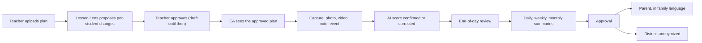
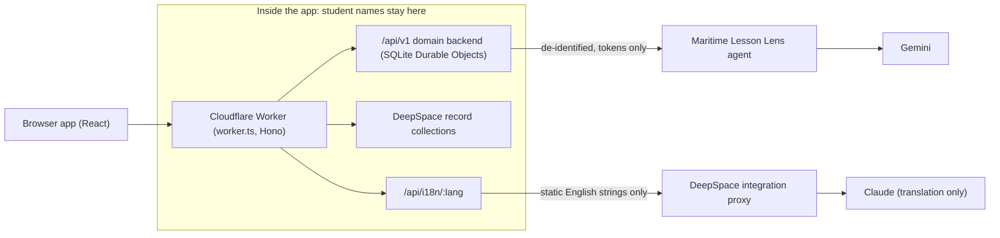
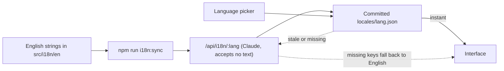
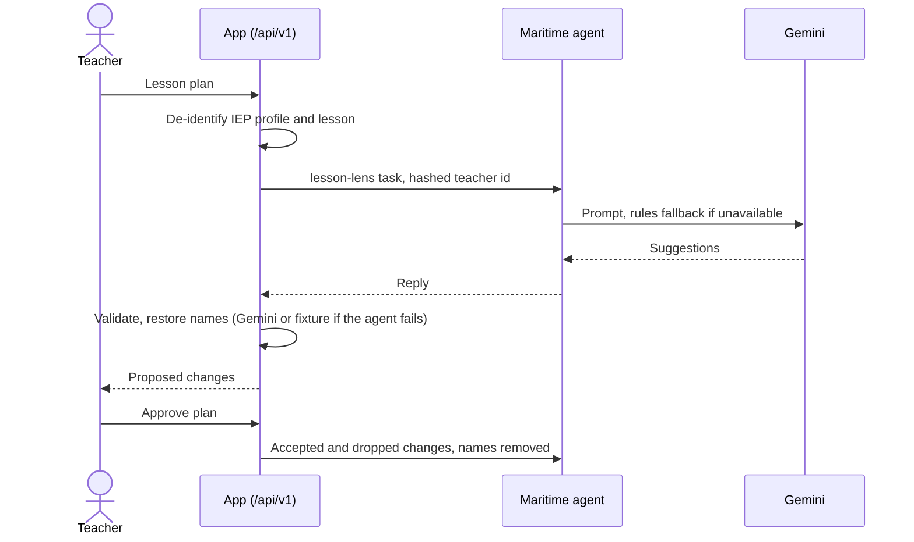

# Altamyra

A living IEP for designated students in BC public schools, who always have an education assistant (EA).

Teachers and EAs adapt every lesson to each student's IEP goals and keep a daily record of progress, mostly after hours. Altamyra turns that into one short daily loop and drafts the summaries, so people only review and approve. Built at HackCamp 2026.

**Contents:** [Product](#product) · [Tech stack](#tech-stack) · [Project layout](#project-layout) · [Run locally](#run-locally) · [Languages](#languages) · [Lesson Lens](#lesson-lens-on-maritime) · [Teamwork and Entire](#working-together) · [Design](#design) · [More docs](#more-docs)

## Product

### Daily loop

| Step | Who | What happens |
| --- | --- | --- |
| 1. Plan | Teacher | Uploads the lesson plan, reviews the per-student changes proposed by Lesson Lens, approves the tailored plan |
| 2. Teach | EA | Opens the app, sees the approved plan for each assigned child |
| 3. Capture | EA (and teacher) | Photos of coded sheets, video, typed notes, events (prompt levels, counters, timers, voice notes). Whoever captured it confirms or corrects the AI score |
| 4. Review | EA | A short end-of-day review of each child, which completes that day's record |

The loop from plan to summaries:



### Summaries

| Summary | Audience |
| --- | --- |
| Daily | EA and teacher |
| Weekly | Case manager (whole caseload) |
| Monthly | Parent or guardian (family's language, with audio); district lead (anonymized, groups under 10 hidden) |

### Roles

| Role | Sees and does |
| --- | --- |
| EA (assigned students) | Full IEP, lesson plans, capture, end-of-day review, progress, monthly approval |
| Teacher (own classes) | The same, plus add and edit lesson plans |
| Case manager (caseload) | Import IEPs, submit change tickets, weekly summary |
| School administrator | Reviews and applies IEP change tickets, assigns roles |
| Parent or guardian (own child) | Monthly summary, consent for voice notes and videos |
| District lead | Monthly anonymized district summary only |

### Rules the product holds to

- **Approval:** anything AI writes or edits (plans, scores, summaries, translations, audio scripts) is a draft only the EA or teacher sees until one approves it. The backend enforces this, not just the screens.
- **Names:** student names are removed before anything reaches an AI model.
- **Records:** MyEducation BC stays the official IEP record; Altamyra is the working layer around it.
- **Data:** fictional data only until district privacy approval; stored in Canada.
- **Accessibility:** Atkinson Hyperlegible, WCAG 2.2 AA, status shown by icon and word, never colour alone.

Everything runs in a local demo on fictional data. Settings (profile, preferences, text size, signed-in devices) and the 36 interface languages work for every role.

## Tech stack

| Layer | What we use |
| --- | --- |
| Platform | [DeepSpace](https://docs.deep.space) SDK on Cloudflare Workers: auth, record storage, server actions, deploys |
| Frontend | React 19, TypeScript, Vite, React Router 7 (file-based routes), Tailwind CSS v4, Base UI, Atkinson Hyperlegible |
| Backend | Cloudflare Worker (`worker.ts`) with Hono; SQLite Durable Objects for the `/api/v1` domain (`src/server/altamyra/`) |
| AI | One de-identifying pipeline (`src/server/altamyra/ai/`): Lesson Lens goes to the agent on [Maritime](https://maritime.sh), which calls Gemini; everything else (and Lesson Lens when the agent fails) calls Gemini directly; fixture provider when no key is set. Claude (via DeepSpace) for interface translation |
| Motion | Plain CSS and Tailwind, shared timing tokens, Lenis smooth scroll; off under `prefers-reduced-motion` |
| Testing | Vitest (unit), Playwright (smoke, API, end-to-end), axe-core accessibility, ESLint, `tsc` |
| Agent workflow | [Entire](https://docs.entire.com): session capture, code graph, shared project memory |

## Project layout

```
worker.ts                Worker entry: registers routes and Durable Objects
agent/                   Lesson Lens agent for Maritime (Node, Gemini; own README)
docs/                    Product analysis, BC IEP policy, decision records, agent workflow
scripts/                 i18n-sync.mjs (writes the translation files)
tests/                   Playwright suites, a11y (axe) and fixtures
public/                  Static assets
.entire/                 Entire config, redaction rules, agent guide
src/
  pages/                 File-based routes: landing (static), (app)/ home, sign-in/up,
                         (protected)/ capture, end-of-day, students, progress, summaries,
                         family, insights, admin, settings
  components/            ui/ (design system), auth/, capture/, lens/, students/
  lib/                   Shared hooks; lib/altamyra/ holds the API clients
  i18n/                  Language provider, en/*.ts strings, locales/*.json translations
  schemas/, schemas.ts   Record collections and permissions (shared by worker and app)
  actions/               Server action map (empty; AI runs in /api/v1)
  server/                HTTP, realtime and action routes, i18n route, AI tools,
                         altamyra/ = the /api/v1 domain backend (own README)
```

Backend: `worker.ts`, `src/server/**`, `src/actions/`. Shared: `src/schemas*`. Everything else under `src/` is frontend.

How the pieces connect; student names never leave the app boundary.



## Run locally

```sh
npm ci
npx deepspace login
```

Create a secrets config (any name; below it is `avi-local`) with `ALTAMYRA_DEV_SEED=true`. `GEMINI_API_KEY`, `MARITIME_AGENT_URL` and `MARITIME_AGENT_TOKEN` are optional: without a Gemini key the AI features use the built-in fixture provider. Never commit or print secrets, and never edit `.dev.vars` (DeepSpace rewrites it from the secret store).

```sh
npx deepspace dev start --host 127.0.0.1 --port 5173 --secrets-config avi-local
```

Open http://127.0.0.1:5173, sign in, and on Home press **Load demo data** (a fictional school, three students, IEPs, lesson plans, progress). Use **Act as** to switch between the six roles; navigation and data follow the role.

| Demo control (Home) | What it does |
| --- | --- |
| **Load demo data** | Seeds the fictional school, dated from now. A second press answers "already seeded" |
| **Reset demo data** | Wipes the demo rows and reseeds them dated from today (`POST /api/v1/dev/seed` with `{"reset": true}`) |
| **Run full demo day** | Adds one fictional student (IEP in `docs/demo/sample-iep-sd23.txt`) and runs a whole school day through the real API, acting as each role in turn, with a link to each result. Live Gemini if `GEMINI_API_KEY` is set (up to a minute), fixtures otherwise (`POST /api/v1/dev/demo-day`) |

The demo controls and `/api/v1/dev/*` routes exist only when `ALTAMYRA_DEV_SEED=true`; they answer 404 otherwise. Never set it in a deploy.

### Try the daily flow

1. **Act as** teacher: upload a lesson plan, review the proposed changes, approve the tailored plan.
2. **Act as** EA: see the approved plan, open **Capture**, add a note, event, photo or video, confirm the AI score.
3. Run **End of day review**, then approve the daily summary in **Summaries**.
4. Approve the monthly summary, then **Act as** parent: the family page shows it in Spanish with audio. Drafts never reach the parent.

### Commands

```sh
npm run build        # production build and prerender
npm run type-check   # tsc --noEmit
npm run lint         # eslint
npm run test:unit    # vitest
npm run test         # Playwright suites via deepspace
npm run i18n:sync    # refresh translation files (see Languages)
npx deepspace deploy # deploy to <app>.app.space (commit first)
```

Accessibility check (axe-core, every role's screens; needs one test account from `npx deepspace test accounts create --email <name>@deepspace.test --name "<name>" --password-stdin`):

```sh
npx deepspace test run tests/a11y/axe.spec.ts --port 5197 --secrets-config avi-local
```

## Languages

The interface shows in 36 languages (English plus 35) from a language picker on the landing, sign-in, dashboard and Settings pages. There is no i18n library, only a small system in `src/i18n/`.

| Piece | Role |
| --- | --- |
| `src/i18n/en/*.ts` | The only English source. Shown with `t('key')` or `<T k="key" />` (inline `<hl>`, `<b>` tags). Brand names use `{app}` |
| `src/i18n/locales/<lang>.json` | Committed machine translations; they load instantly, with no AI call |
| `/api/i18n/:lang` | Fallback route that translates the English catalogue with Claude for languages or strings missing from the files, then caches it. It accepts no text, so student names and record data never reach the translator |
| Lesson Lens | Not translated afterwards: the agent writes its suggestions in the teacher's language |

Committed file first, server fallback second:



**After changing English text:** run `npm run i18n:sync` (app running, signed in to DeepSpace) and commit the changed `locales/` files. Until then, new or edited strings show in English. To add a language, add one line to `src/i18n/languages.ts`. Translations are machine-made and not reviewed by native speakers. See [decision 0010](docs/decisions/0010-committed-machine-translations.md).

## Lesson Lens on Maritime

Suggestions come from an AI agent in `agent/`: a small Node server on [Maritime](https://maritime.sh) that calls Gemini (`gemini-3.5-flash-lite`) and falls back to a rules engine. Each teacher's approvals and rejections are kept in the agent's `/data` and used as examples next time.

1. A teacher pastes or uploads a lesson plan on a student's **Plan** tab.
2. `POST /api/v1/students/:id/lesson-plans` (`src/server/altamyra/routes/lesson-plans.ts`) runs Lesson Lens through the app's one AI pipeline (`ai/functions.ts`): the IEP profile and lesson text are de-identified (names become tokens such as `S-K7Q4`), and the call is refused if any identifier survives.
3. `ai/providers/maritime.ts` sends that de-identified input to the agent's chat API (`lesson-lens` task) with a hashed teacher id and an `mk_` key. The reply is validated against the lens contract. On any failure (error status, no answer in 25 s, unreadable reply) the app calls Gemini directly, or the fixture without a key. Names are put back inside the app, and each adaptation becomes a proposed change; a modification the IEP does not authorize is left out.
4. The teacher accepts or drops each change and approves the plan. The accepted and dropped changes go back to the agent (`feedback` task) with names removed.

What one request does, step by step:



Configure it in DeepSpace's secret store, then restart the dev server:

```sh
npx deepspace secrets set MARITIME_AGENT_URL=https://api.maritime.sh/api/agents/<agent-id>
read -rs MK && printf %s "$MK" | npx deepspace secrets set MARITIME_AGENT_TOKEN --stdin; unset MK   # mk_ key, deploy scope
```

Without them, Lesson Lens calls Gemini directly (or the fixture without a key). Deploy and test steps: [agent/README.md](agent/README.md).

## Working together

Each teammate uses their own clone and their own Claude Code. Setup, once per person:

| Step | What to do |
| --- | --- |
| 1. GitHub | The owner adds you as a collaborator on `vvictort/hackcamp-2026`, then `git clone … && npm install` |
| 2. DeepSpace | The owner runs `npx deepspace app collaborators add <email>`. You accept with `npx deepspace app collaborators invites`, then `npx deepspace auth login && npm run dev`. Secrets, including Maritime's, load automatically. Collaborators can read every app secret and deploy to the live URL, so add only people you trust |
| 3. Entire | Follow [Set up Entire](#set-up-entire), then restart Claude Code |
| 4. Maritime | Nothing to set up; the agent runs in the owner's account. To change it, edit `agent/`, test (`node --test agent/`), push, and ask the owner to redeploy |

**House rules** (also in Entire Brain):

- Fictional or de-identified data only. Never paste real student information or a secret into an agent prompt: sessions are recorded.
- App settings go in `npx deepspace secrets set`, never `.dev.vars`.
- Several agents may share a clone: commit only your own files (`git add <paths>`, not `-A`), keep one dev server per clone, and commit without a `Co-authored-by` trailer.
- Never push Entire checkpoints to the public repo (see below).

### Entire

[Entire](https://docs.entire.com) keeps the agents' work connected:

| Feature | What it gives you |
| --- | --- |
| Sessions | Each Claude Code session is captured as a checkpoint linked to its commit. Redaction is on (emails, phone numbers, `.entire/redactors/`) |
| Checkpoints | Configured in `.entire/settings.json` to go to the private repo `vvictort/hackcamp-2026-checkpoints` (ask the owner for access). This repo is public, so keep the push policy `manual` and never push transcripts here |
| Graph | Code map: `entire graph query …` |
| Brain | Shared project memory: `entire brain brief "<task>"`; add a rule with `entire brain remember "<rule>" --path project.<area>.<name> --agent none` |
| Agent guide | `.entire/agent-guide.md` tells every agent to use Brain and Graph before working |

#### Privacy

Session transcripts are redacted before they are stored:

- **Built in:** secrets, high-entropy strings, emails, phone numbers and IPs.
- **Shared rules** in [`.entire/redactors/altamyra.yaml`](.entire/redactors/altamyra.yaml): BC PENs, Gemini and Maritime keys, DeepSpace secrets, live Maritime agent URLs and IDs.
- **Personal rules** in `.entire/redactors/local/` (gitignored): put your name, emails, hostname and home path there. Those values then stay out of both the transcripts and this public repo.
- Only fictional demo students appear in sessions. Never paste real student or IEP data.
- Checkpoints go only to the private checkpoint repo, never to this one.

We audited all 361 checkpoints before the first upload: no live keys, tokens or real student data.

#### Set up Entire

```sh
curl -fsSL https://entire.com/install.sh | bash      # macOS: brew install --cask entireio/tap/entire
entire login                                          # WSL/Linux without a keyring: echo '{"token_store": "file"}' > ~/.config/entire/config.json, then log in again
entire enable -y --agent claude-code                  # or codex, cursor, copilot-cli, opencode
entire configure --checkpoint-push-policy manual
entire repo remote add entire --cluster aws-us-east-2.entire.io && git fetch entire
entire plugin install graph && entire graph setup
entire plugin install brain && entire brain setup && entire brain connect   # answer no to backfill
```

The first commit after `entire enable` may ask to link session context: answer `a` (always). Restart Claude Code afterwards.

## Design

Ink-first and light only: a soft grey canvas, white and near-black cards, tightly tracked headings, one violet accent used sparingly, no decorative dots. Tokens and shape rules are at the top of `src/styles.css`. Reuse the pieces in `src/components/ui` instead of hand-rolling cards and buttons.

## More docs

| File | What it is |
| --- | --- |
| [docs/product-analysis.md](docs/product-analysis.md) | The problem, modules, personas, rules, and what is built |
| [docs/policy/bc-iep.md](docs/policy/bc-iep.md) | Sourced summary of BC IEP and reporting policy |
| [docs/decisions/](docs/decisions/README.md) | Architecture decision records |
| [docs/agent-workflow.md](docs/agent-workflow.md) | How agents and humans work in this repo |
| [src/server/altamyra/README.md](src/server/altamyra/README.md) | The `/api/v1` backend: folders, roles, capabilities |
| [agent/README.md](agent/README.md) | Deploying and testing the Lesson Lens agent |
